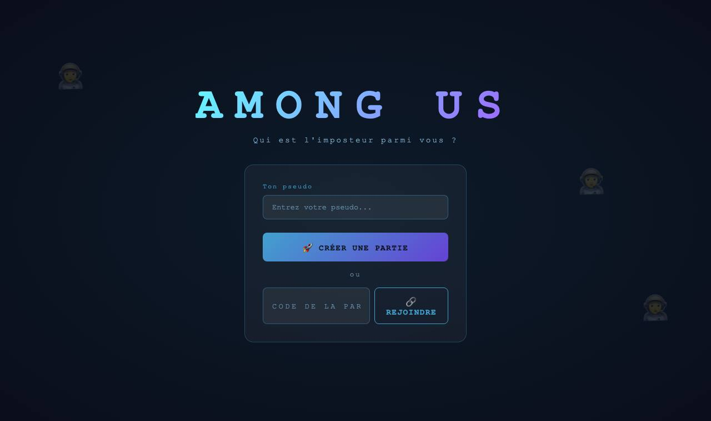
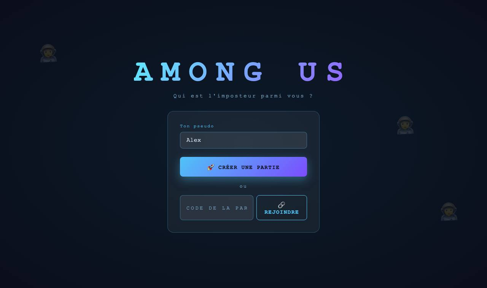
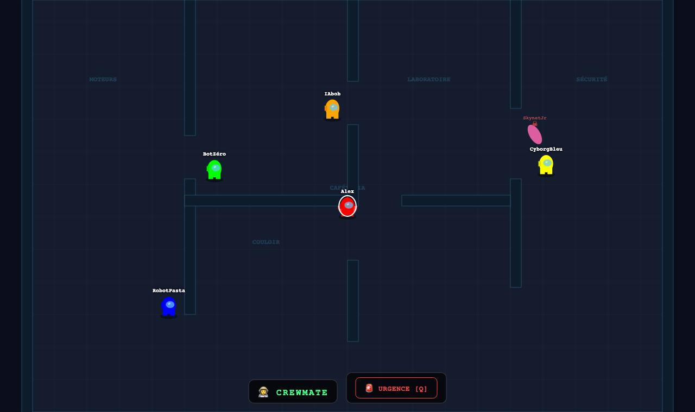

# Among Us — version navigateur

Un **Among Us multijoueur jouable dans le navigateur**, que j'ai fait quand j'étais au collège. On crée une partie, on partage le code, on complète avec des bots, et on essaie de démasquer l'imposteur.

| Accueil | Salon d'attente | En partie |
|---|---|---|
|  |  |  |

## Le jeu

- **Partie** : de 4 joueurs minimum, bots compris. Il y a 1 imposteur, 2 à partir de 7 joueurs et 3 à partir de 10.
- **Carte** : une station avec des salles (Cafétéria, Moteurs, Laboratoire, Sécurité, Couloir…).
- **Contrôles** :

  | Touche | Action |
  |---|---|
  | ZQSD / WASD / flèches | se déplacer (il y a aussi des flèches à l'écran sur mobile) |
  | E | tuer (imposteur) |
  | F | signaler un corps |
  | Q | réunion d'urgence |

- **Réunions** : 60 s de discussion dans le chat, puis 30 s de vote pour éjecter quelqu'un.
- **Bots** : ils se déplacent, tuent s'ils sont imposteurs (avec une attente de 10 s entre deux meurtres) et écrivent dans le chat. Ils ont des noms comme BotZéro, CyborgBleu ou SkynetJr.

## Lancer

```bash
npm install
npm start          # ou : npm run dev (redémarre tout seul à chaque modification)
```

Ouvre ensuite http://localhost:3000. Tes amis peuvent rejoindre la partie avec ton adresse sur le réseau local.

## Technique

- **`server.js`** : Node.js, Express et Socket.io. Le serveur gère les salons (code à 6 caractères), les rôles, les déplacements, les meurtres, les signalements, les votes et l'IA des bots.
- **`public/`** : `index.html`, `css/style.css` et `js/jeu.js` (rendu Canvas, touches, chat, vote).

## État actuel

- **Le panneau des bots manque dans `index.html`** : `jeu.js` cherche `#zone-bots`, les boutons `.bouton-bot` et `#btn-retirer-bots`, qui n'existent pas dans la page.
- **Conséquences** :
  - le script s'arrête à cet endroit (« Cannot read properties of null »), donc certaines fonctions ne sont pas branchées, comme le chat ou la touche Entrée sur le pseudo ;
  - on ne peut pas ajouter de bots depuis l'interface.
- **Ce qui marche quand même** : le serveur gère bien les bots et la partie se lance (captures ci-dessus).

---
*Projet de fan, non officiel. Among Us est une marque d'Innersloth.*
